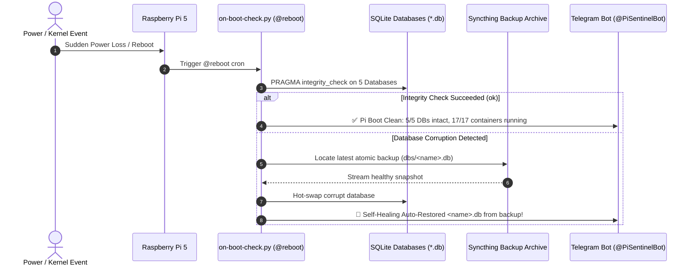
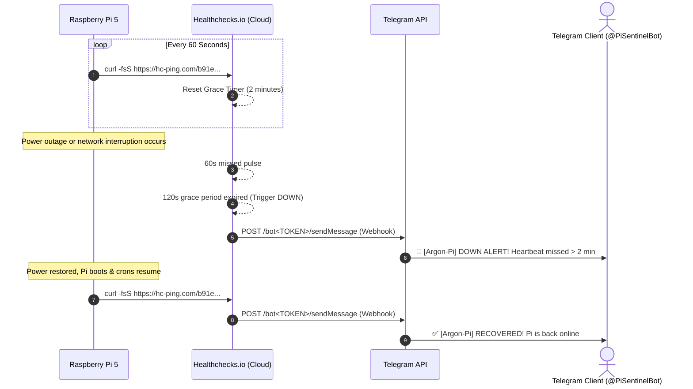

# My Pi v2.2 — Homelab, Security & Cyber-Intelligence Suite

A production-ready collection of lightweight security, intelligence, and privacy microservices tailored for the Raspberry Pi (4GB RAM, 32GB microSD), complete with automated self-healing, cloud dead-man's switch, and native mobile companion client.

---

## 🏛️ System Architecture

```mermaid
flowchart TD
    subgraph Client["📱 Client Layer (Argon Mobile Hub)"]
        UI["Jetpack Compose UI\n(Native Hub & HUD)"]
        NM["NetworkManager\n(10s Active Heartbeat)"]
        OTA["OtaManager\n(OTA Auto-Update Client)"]
        AUTH_CLIENT["AuthManager\n(JWT Session & RBAC)"]
        
        UI --> NM
        UI --> OTA
        UI --> AUTH_CLIENT
    end

    subgraph Network["🌐 Transport & Overlay Network"]
        LAN["Home Wi-Fi / LAN\n(192.168.1.10)"]
        TS["Tailscale Mesh VPN\n(100.123.87.122 / argon-host)"]
        STUN["WebRTC / STUN\n(Google & Cloudflare STUN)"]
    end

    NM -->|"Direct LAN (400ms)"| LAN
    NM -->|"WireGuard Tunnel (1200ms)"| TS
    UI -->|"P2P File Transfer"| STUN

    subgraph Server["🍓 Argon Pi Infrastructure (Raspberry Pi 5)"]
        subgraph Ingress["Gateway & Ingress"]
            CADDY["Caddy Reverse Proxy\n(Port 80 & 5050)"]
            AUTH_SRV["Argon Auth Gateway\n(FastAPI • Port 8089)\n/api/health • /api/auth • /api/version"]
        end

        subgraph Containers["Docker Microservices (22 Stacks)"]
            direction TB
            VW["Vaultwarden (Passwords)"]
            SYNC["Syncthing (Multi-Device Sync)"]
            KUMA["Uptime Kuma (Service Monitor)"]
            BESZEL["Beszel (System Metrics)"]
            CROWD["CrowdSec (Intrusion Defense)"]
            COWRIE["Cowrie (SSH/Telnet Honeypot)"]
            LLM_POT["LLM Shell Honeypot (Gemini Deception)"]
            LAN_HUNT["Ghost LAN Hunter (MAC Rotation Filter)"]
            USB_SEC["USB Forensics Bay (Auto-quarantine)"]
            OSINT["Nocturnal OSINT Agent (Qdrant & Gemini)"]
            NOISE["Noise Machine (ISP Profile Poisoning)"]
            WATCHER["Stock Watcher & AI Summarizer"]
            TOWER["Watchtower (Nightly Container Updates)"]
            OTHER["PairDrop, Stirling-PDF, IT-Tools, etc."]
        end

        subgraph BackgroundJobs["Self-Healing & Cron Daemons"]
            CRON_PING["healthchecks-ping.sh\n(Every 1 min cron)"]
            CRON_BACKUP["backup-pi.sh\n(Every 6 hrs atomic SQLite & .env)"]
            ON_BOOT["on-boot-check.sh\n(@reboot SQLite PRAGMA integrity check)"]
        end
    end

    LAN --> CADDY
    TS --> CADDY
    LAN --> AUTH_SRV
    TS --> AUTH_SRV
    CADDY --> Containers

    subgraph CloudOps["☁️ External Monitoring & Alerting"]
        HC["Healthchecks.io\n(Dead-Man's Switch • 2 min grace)"]
        TG["Telegram Bot API\n(@PiSentinelBot)"]
    end

    CRON_PING -->|"1-min pulse"| HC
    HC -->|"Downtime Webhook"| TG
    CRON_BACKUP -->|"Backup Report"| TG
    ON_BOOT -->|"Integrity Report"| TG
    COWRIE -->|"Threat Alerts"| TG
    LLM_POT -->|"Live Keystrokes & Probes"| TG
    LAN_HUNT -->|"Rogue Device Alerts"| TG
    USB_SEC -->|"Storage Threat Dossiers"| TG
    OSINT -->|"Morning Threat Briefing"| TG
    WATCHER -->|"Market / News Summaries"| TG

    subgraph DevOps["🚀 CI/CD & Delivery (GitHub Actions)"]
        REPO_PI["my-pi (Main Server Repo)\n• PR Version Gate (VERSION)\n• Deploy to Pi via Tailscale SSH"]
        REPO_APP["my-pi-mobile (Android Repo)\n• PR Version Gate (versionCode + 1)\n• Fast Kotlin Lint Check\n• Release Build & Deploy to :5050 OTA"]
    end

    REPO_PI -->|"SSH Deploy"| Server
    REPO_APP -->|"Deploy APK & version.json"| CADDY
```



> [!NOTE]
> For the in-depth architectural breakdown including sequence diagrams, see [ARCHITECTURE.md](docs/ARCHITECTURE.md).

---

## 🚀 Active Services & Web Dashboards

| Service | Port / Protocol | Web UI Access | Role |
| :--- | :--- | :--- | :--- |
| **Homepage** | `80` (HTTP) | `http://192.168.1.10/` | Unified homelab HUD with real-time stats & service cards |
| **Argon Auth & RBAC** | `8089` (HTTP) | `http://192.168.1.10:8089/admin` | Multi-user identity, Google OIDC & role access management |
| **Sentinel Bot** | Background Worker | Telegram (`@ArgonPiSentinelBot`) | News watcher, Wi-Fi sentry, system ops |
| **AdGuard Home** | `53` (DNS), `3000`/`8080` (HTTP) | `http://192.168.1.10:8080` | Network-wide ad & telemetry sinkhole |
| **Chromium Sandbox** | `3002` (HTTP), `3003` (HTTPS) | `https://192.168.1.10:3003` | Disposable WebRTC cleanroom browser |
| **Uptime Kuma** | `3001` (HTTP) | `http://192.168.1.10:3001` | Service health & latency monitor |
| **Cowrie Honeypot** | `2222` (SSH), `2223` (Telnet) | `ssh -p 2222 root@pi` | Deception honeypot & attack logger with Gemini 2.5 Flash threat dossiers |
| **LLM Shell Honeypot** | `2224` (TCP), `8091` (HTTP) | `http://192.168.1.10:8091/` | Gemini-powered interactive root deception shell & honey-tokens |
| **Ghost LAN Hunter** | `8093` (HTTP) | `http://192.168.1.10:8093/devices` | Rogue device sentinel with MAC rotation filter & 24h learning baseline |
| **USB Forensics Bay** | `8094` (HTTP) | `http://192.168.1.10:8094/scans` | Read-only auto-quarantine sandbox & Gemini malware risk analyzer |
| **Nocturnal OSINT Agent** | `8095` (HTTP) | `http://192.168.1.10:8095/api/briefing` | Qdrant semantic memory & automated morning threat briefings |
| **Noise Machine** | `8092` (HTTP) | `http://192.168.1.10:8092/metrics` | Autonomous background web traffic & ISP profile poisoning worker |
| **CrowdSec** | `8081` (LAPI) | Background Daemon | Collaborative threat defense & firewall bouncer |
| **Vaultwarden** | `8085` (HTTP), `8443` (HTTPS) | `https://192.168.1.10:8443` | Self-hosted Bitwarden password & secret vault |
| **Stirling-PDF** | `8086` (HTTP) | `http://192.168.1.10:8086` | 100% private in-browser document editor & OCR |
| **Qdrant Vector DB** | `6333` (REST/UI), `6334` (gRPC) | `http://192.168.1.10:6333/dashboard` | High-performance vector database for AI embeddings & RAG |
| **Syncthing** | `8384` (HTTP), `22000` (Sync) | `http://192.168.1.10:8384` | Encrypted P2P file & Obsidian note sync |
| **Docker Registry** | `5000` (API), `5001` (HTTP UI) | `http://192.168.1.10:5001` | Private local container registry & web catalog |
| **Tailscale Node** | WireGuard Mesh | `100.123.87.122` | Subnet router & encrypted exit node |

---

## ⚡ Power Loss, Resilience & Self-Healing Architecture

The Pi is engineered to withstand abrupt power cuts and automatically recover with zero data loss:
* **Automatic Boot Orchestration:** Docker daemon and Tailscale are systemd-enabled (`systemctl enable docker tailscaled`).
* **Container Self-Healing:** Every service runs with `restart: unless-stopped` — all 17 containers launch immediately when power is restored.
* **On-Boot SQLite PRAGMA Integrity Checks:** `@reboot` cron executes `scripts/on-boot-check.py` to verify all 5 SQLite databases (`users.db`, `vaultwarden.db`, `uptime-kuma.db`, `beszel.db`, `stock-watcher.db`). If corruption is found, it automatically hot-swaps the corrupt database with the latest healthy snapshot from Syncthing.
* **6-Hourly Atomic Snapshots:** Background cron runs `scripts/backup-pi.sh` using SQLite `PRAGMA vacuum_into` for zero-lock atomic backups, archived to Syncthing and verified on Telegram.
* **External Dead-Man's Switch (Healthchecks.io):** A 1-minute cron (`scripts/healthchecks-ping.sh`) pings Healthchecks.io. If power or internet drops for > 2 minutes, Healthchecks cloud triggers a direct Telegram alert to `@PiSentinelBot`.
* **Hardware Watchdog:** Broadcom hardware watchdog enabled (`RuntimeWatchdogSec=15s`) to automatically reboot if the kernel ever freezes.

### On-Boot Self-Healing Flow


### Cloud Dead-Man's Switch (Healthchecks.io)


---

## 📱 Telegram Bot Commands

Send any of these commands to **Pi Sentinel** in Telegram:

### Hardware & Network
* `/pi` — Real-time CPU temp (°C), RAM, Disk, Load, and Docker containers
* `/devices` — Lists active Wi-Fi/LAN devices, hardware vendor, and connection time in IST
* `/ping` — Measures network latency to Cloudflare (`1.1.1.1`) and Google (`8.8.8.8`)

### Security & Developer Tools
* `/scan <url>` — Headless redirect chain tracker and payload risk inspector
* `/web <url>` — Fetches any article/blog and creates a clean executive summary
* `/cve <package>` — Instant vulnerability search across OSV and NVD
* `/trending` — Top trending open-source AI/LLM GitHub repositories

### Feed & Watchlist Control
* `/interval <mins>` — Change feed check frequency (e.g. `/interval 30`)
* `/age <hours>` — Set publication freshness cutoff (e.g. `/age 24`)
* `/check` — Run an immediate manual feed check
* `/status` — View current bot configuration and database metrics
* `/list` — Display active stock/crypto/security keywords
* `/add <word>` / `/remove <word>` — Modify watchlist tickers dynamically

---

## 🛡️ Cyber-Deception, Forensics & OSINT Suite (v2.2)

### 1. LLM Shell Honeypot Trap (`llm-honeypot`)
* **Ports:** `2224` (TCP interactive terminal), `8091` (Web deception terminal)
* **How it Works:** Connected to Google Gemini 2.5 Flash, simulating a compromised research node (`darpa-quantum-vault-04`). Attackers can type any bash command (`ls`, `cat /etc/shadow`, `sudo -l`, `whoami`) and receive authentic Linux outputs with fake honey-tokens, fake credentials, and fake bitcoin wallets containing zip-bombs.
* **Alerting:** Live keystrokes and sessions are dispatched directly to Telegram in real time.

### 2. Ghost-in-the-LAN Sentinel (`ghost-lan-hunter`)
* **Port:** `8093` (HTTP Metrics & Device Registry: `http://192.168.1.10:8093/devices`)
* **Smart MAC Randomization Filter:** Automatically detects IEEE 802 Locally Administered Address (LAA) bits. When modern iPhones, Androids, or MacBooks refresh their private Wi-Fi addresses, it correlates them via DHCP Hostname and mDNS, updating `known_devices.json` silently without false alarms.
* **Learning Mode:** Features an initial 24-hour quiet learning baseline before switching to active alerting for true uncataloged strangers.

### 3. USB Forensics & Quarantine Bay (`usb-forensics`)
* **Port:** `8094` (Forensic API & Audit Log: `http://192.168.1.10:8094/scans`)
* **Auto-Quarantine Sandbox:** Automatically mounts external USB flash drives strictly read-only (`mount -o ro,nosuid,nodev,noexec`).
* **Deep File Scan:** Recursively walks the drive, computes SHA-256 hashes, flags high-risk executables, scripts, autorun files, and LNK exploits, and queries Gemini 2.5 Flash for forensic risk classification before sending an incident dossier to Telegram.

### 4. Nocturnal OSINT Web Agent (`nocturnal-osint`)
* **Port:** `8095` (REST API & Semantic Query: `http://192.168.1.10:8095/api/briefing`)
* **Configuration:** Driven by `nocturnal-osint/config/osint_targets.yml` (supports stack CVE keywords, RSS feeds, custom web watchers, and schedules).
* **Qdrant Vector Storage:** Automatically vectorizes threat intelligence with Gemini Embeddings (3072 dims) and stores it in the local Qdrant collection (`osint_intelligence`).
* **Morning Briefing:** Dispatches a synthesized 4-bullet Morning Threat & Tech Briefing to Telegram at 7:00 AM UTC.

### 5. Noise Machine (`noise-machine`)
* **Port:** `8092` (HTTP Metrics: `http://192.168.1.10:8092/metrics`)
* **ISP Profile Poisoning:** Background async worker (~15 MB RAM) issuing benign requests with rotating User-Agents and human jitter delays across diverse domains (Wikipedia, arXiv, NASA, GitHub, OpenAlex), completely destroying ISP behavioral profiling telemetry.

---

## 🛠️ Management & CI/CD Deployment

### Branch & PR Workflow Convention
1. Create a feature branch from `main`:
   ```bash
   git checkout -b feat/your-feature
   ```
2. Make changes, commit, and push to GitHub:
   ```bash
   git push -u origin feat/your-feature
   ```
3. Open a Pull Request to `main`. GitHub Actions will automatically run linting and validate all Docker Compose syntax.
4. On merging the PR into `main`, GitHub Actions automatically connects over Tailscale and deploys to the Raspberry Pi!

### Local Deployment
You can also run deployment manually from Mac or directly on the Pi:
- **From Mac:**
  ```bash
  ./deploy.sh
  ```
- **Directly on the Pi:**
  ```bash
  ./scripts/deploy-local.sh
  ```

### Required GitHub Secrets (Repository Settings -> Secrets -> Actions)
* `TAILSCALE_AUTHKEY` — Tailscale Auth Key (generated from Tailscale Admin Console)
* `PI_HOST` — Tailscale IP of the Pi (`100.123.87.122`)
* `PI_USER` — `argon`
* `PI_SSH_KEY` — Private SSH key authorized in `/home/argon/.ssh/authorized_keys`
