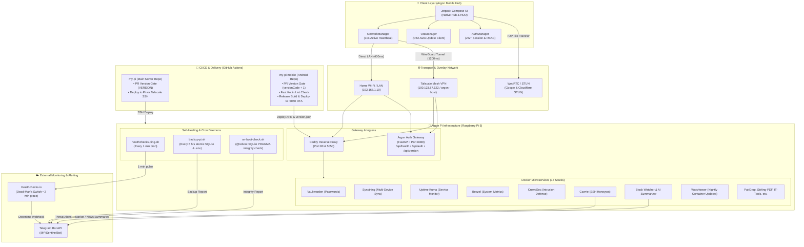
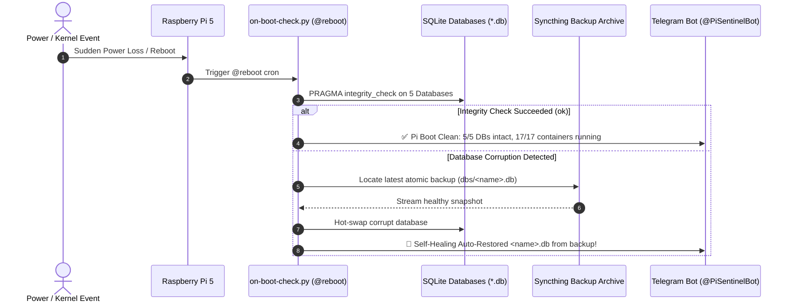
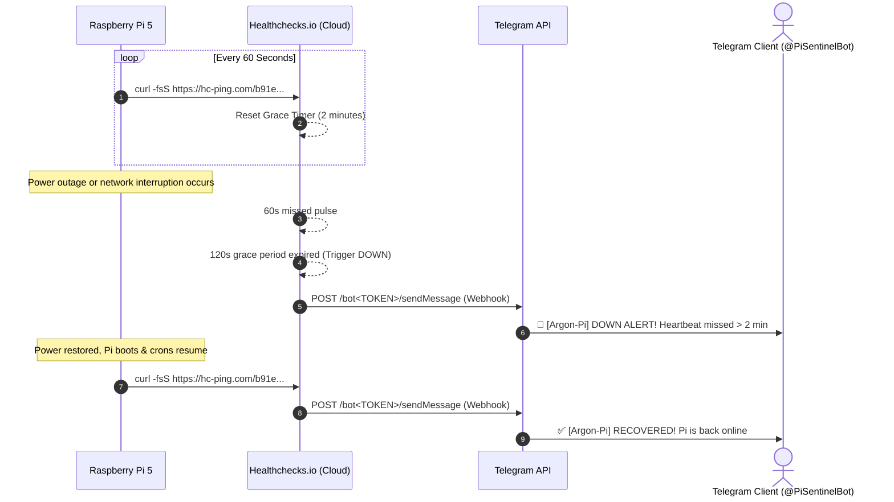

# My Pi v2.1 — Homelab & Security Ops Suite

A production-ready collection of lightweight security, intelligence, and privacy microservices tailored for the Raspberry Pi (4GB RAM, 32GB microSD), complete with automated self-healing, cloud dead-man's switch, and native mobile companion client.

---

## 🏛️ System Architecture



> [!NOTE]
> For the in-depth architectural breakdown including sequence diagrams, see [ARCHITECTURE.md](docs/ARCHITECTURE.md).

---

## 🚀 Active Services & Web Dashboards

| Service | Port / Protocol | Web UI Access | Role |
| :--- | :--- | :--- | :--- |
| **Homepage** | `80` (HTTP) | `http://192.168.1.10/` | Unified homelab HUD with real-time stats & service cards |
| **Argon Auth & RBAC** | `8089` (HTTP) | `http://192.168.1.10:8089/admin` | Multi-user identity, Google OIDC & role access management |
| **Sentinel Bot** | Background Worker | Telegram (`@ArgonPiSentinelBot`) | News watcher, Wi-Fi sentry, system ops |
| **AdGuard Home** | `53` (DNS), `3000`/`8080` (HTTP) | `http://192.168.1.10:8080` | Network-wide ad & telemetry sinkhole |
| **Chromium Sandbox** | `3002` (HTTP), `3003` (HTTPS) | `https://192.168.1.10:3003` | Disposable WebRTC cleanroom browser |
| **Uptime Kuma** | `3001` (HTTP) | `http://192.168.1.10:3001` | Service health & latency monitor |
| **Cowrie Honeypot** | `2222` (SSH), `2223` (Telnet) | `ssh -p 2222 root@pi` | Deception honeypot & attack logger |
| **CrowdSec** | `8081` (LAPI) | Background Daemon | Collaborative threat defense & firewall bouncer |
| **Vaultwarden** | `8085` (HTTP), `8443` (HTTPS) | `https://192.168.1.10:8443` | Self-hosted Bitwarden password & secret vault |
| **Stirling-PDF** | `8086` (HTTP) | `http://192.168.1.10:8086` | 100% private in-browser document editor & OCR |
| **Qdrant Vector DB** | `6333` (REST/UI), `6334` (gRPC) | `http://192.168.1.10:6333/dashboard` | High-performance vector database for AI embeddings & RAG |
| **Syncthing** | `8384` (HTTP), `22000` (Sync) | `http://192.168.1.10:8384` | Encrypted P2P file & Obsidian note sync |
| **Docker Registry** | `5000` (API), `5001` (HTTP UI) | `http://192.168.1.10:5001` | Private local container registry & web catalog |
| **Tailscale Node** | WireGuard Mesh | `100.123.87.122` | Subnet router & encrypted exit node |

---

## ⚡ Power Loss, Resilience & Self-Healing Architecture

The Pi is engineered to withstand abrupt power cuts and automatically recover with zero data loss:
* **Automatic Boot Orchestration:** Docker daemon and Tailscale are systemd-enabled (`systemctl enable docker tailscaled`).
* **Container Self-Healing:** Every service runs with `restart: unless-stopped` — all 17 containers launch immediately when power is restored.
* **On-Boot SQLite PRAGMA Integrity Checks:** `@reboot` cron executes `scripts/on-boot-check.py` to verify all 5 SQLite databases (`users.db`, `vaultwarden.db`, `uptime-kuma.db`, `beszel.db`, `stock-watcher.db`). If corruption is found, it automatically hot-swaps the corrupt database with the latest healthy snapshot from Syncthing.
* **6-Hourly Atomic Snapshots:** Background cron runs `scripts/backup-pi.sh` using SQLite `PRAGMA vacuum_into` for zero-lock atomic backups, archived to Syncthing and verified on Telegram.
* **External Dead-Man's Switch (Healthchecks.io):** A 1-minute cron (`scripts/healthchecks-ping.sh`) pings Healthchecks.io. If power or internet drops for > 2 minutes, Healthchecks cloud triggers a direct Telegram alert to `@PiSentinelBot`.
* **Hardware Watchdog:** Broadcom hardware watchdog enabled (`RuntimeWatchdogSec=15s`) to automatically reboot if the kernel ever freezes.

### On-Boot Self-Healing Flow


### Cloud Dead-Man's Switch (Healthchecks.io)


---

## 📱 Telegram Bot Commands

Send any of these commands to **Pi Sentinel** in Telegram:

### Hardware & Network
* `/pi` — Real-time CPU temp (°C), RAM, Disk, Load, and Docker containers
* `/devices` — Lists active Wi-Fi/LAN devices, hardware vendor, and connection time in IST
* `/ping` — Measures network latency to Cloudflare (`1.1.1.1`) and Google (`8.8.8.8`)

### Security & Developer Tools
* `/scan <url>` — Headless redirect chain tracker and payload risk inspector
* `/web <url>` — Fetches any article/blog and creates a clean executive summary
* `/cve <package>` — Instant vulnerability search across OSV and NVD
* `/trending` — Top trending open-source AI/LLM GitHub repositories

### Feed & Watchlist Control
* `/interval <mins>` — Change feed check frequency (e.g. `/interval 30`)
* `/age <hours>` — Set publication freshness cutoff (e.g. `/age 24`)
* `/check` — Run an immediate manual feed check
* `/status` — View current bot configuration and database metrics
* `/list` — Display active stock/crypto/security keywords
* `/add <word>` / `/remove <word>` — Modify watchlist tickers dynamically

---

## 🛠️ Management & CI/CD Deployment

### Branch & PR Workflow Convention
1. Create a feature branch from `main`:
   ```bash
   git checkout -b feat/your-feature
   ```
2. Make changes, commit, and push to GitHub:
   ```bash
   git push -u origin feat/your-feature
   ```
3. Open a Pull Request to `main`. GitHub Actions will automatically run linting and validate all Docker Compose syntax.
4. On merging the PR into `main`, GitHub Actions automatically connects over Tailscale and deploys to the Raspberry Pi!

### Local Deployment
You can also run deployment manually from Mac or directly on the Pi:
- **From Mac:**
  ```bash
  ./deploy.sh
  ```
- **Directly on the Pi:**
  ```bash
  ./scripts/deploy-local.sh
  ```

### Required GitHub Secrets (Repository Settings -> Secrets -> Actions)
* `TAILSCALE_AUTHKEY` — Tailscale Auth Key (generated from Tailscale Admin Console)
* `PI_HOST` — Tailscale IP of the Pi (`100.123.87.122`)
* `PI_USER` — `argon`
* `PI_SSH_KEY` — Private SSH key authorized in `/home/argon/.ssh/authorized_keys`
