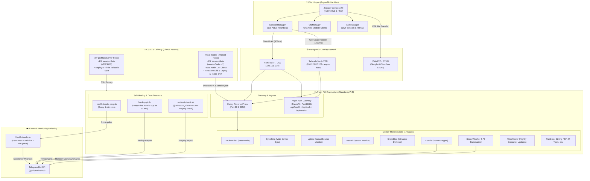
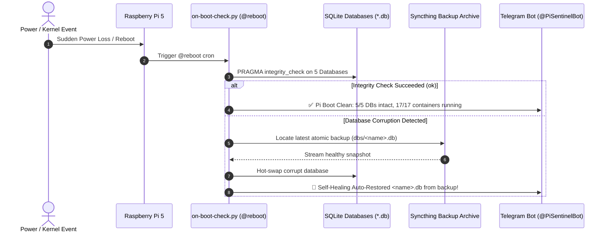
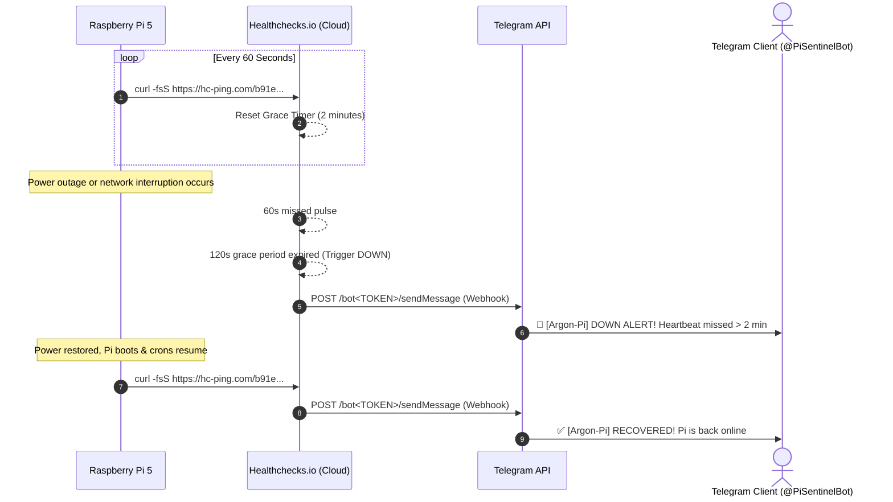
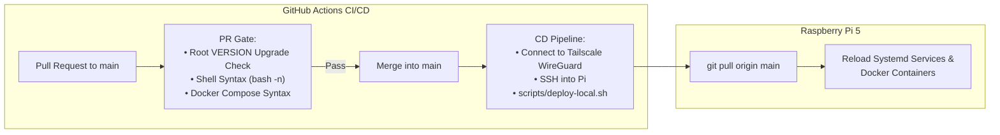

# Argon Pi Ecosystem Architecture Specification

This document provides a comprehensive architectural specification of the **Argon Pi** home server ecosystem, including network topology, container stacks, self-healing engines, external dead-man's switch, and CI/CD pipelines.

---

## 1. End-to-End System Topology

---

## 2. Server-Side Resilience & Self-Healing Sequence

---

## 3. External Dead-Man's Switch Heartbeat

---

## 4. CI/CD Deployment Architecture

